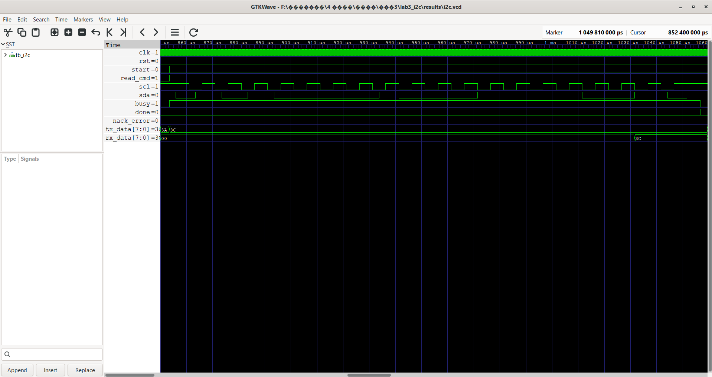
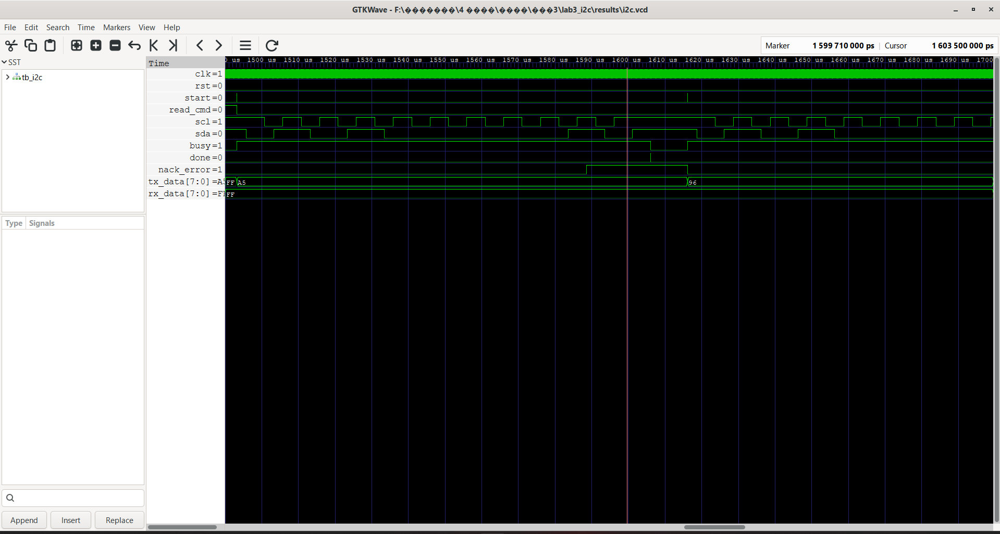
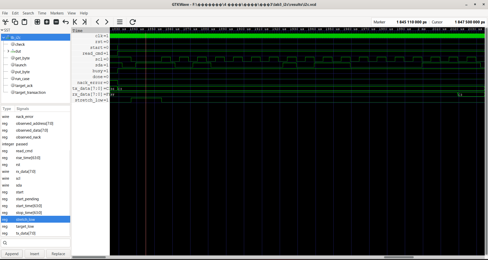

# Лабораторна робота 3 — I2C на Verilog

Студент: Цегинька Назар Олегович. Група КІ-405. Варіант 26.

## Реалізація

Один контролер, 7-бітна адреса, один байт на команду. Запис, читання,
ACK/NACK і clock stretching. Системний CLK 50 МГц; номінальний SCL 100 кГц.

- `rtl/i2c_tx.v` — серіалізація байта старшим бітом уперед.
- `rtl/i2c_rx.v` — збирання отриманого байта.
- `rtl/i2c_master.v` — FSM, дільник, синхронізатори, START/STOP і ACK.
- `rtl/i2c_top.v` — двонапрямні лінії відкритого стоку.
- `tb/tb_i2c.v` — незалежна модель зовнішнього пристрою та перевірки.
- `docs/screenshots/` — сім власних скріншотів студента.
- `results/` — журнали вже виконаного локального запуску.
- `report/lab3_report.docx` — звіт із кодом і власними скріншотами.

## Повторення симуляції

Потрібні Icarus Verilog (`iverilog` і `vvp`).
У цій папці на Linux або Git Bash:

```sh
bash run_simulation.sh
```

Очікуваний підсумок: `ALL PASS: 13 scenarios`.
Перевірено запис A5/00/FF/5A, читання 3C/00/FF, NACK адреси й даних,
читання C3 із затримкою SCL, команду під час busy, RESET і відновлення.

## Повний запуск на Windows

Потрібен OSS CAD Suite. Якщо шлях містить кирилицю, відкрий PowerShell:

```powershell
subst R: "F:\політех\4 курс\АПКС\work\oss-cad-suite"
powershell.exe -NoProfile -ExecutionPolicy Bypass -File .\run_all.ps1 -SuitePath "R:\"
subst R: /D
```

Команди виконуй із папки `lab3` цього репозиторію. За іншого розташування
зміни шлях у `subst`. Віртуальний диск не копіює інструменти.
Комплектні журнали підтверджують Icarus exit=0 і vvp exit=0.
Скрипт також перевіряє відомий Windows-збій Icarus після формування файла:
допускається лише новий файл і проходження всіх 13 тестів.
Для nextpnr перевіряється код завершення; попередження не є успіхом або помилкою самі по собі.

## Результати попередньої локальної перевірки

| Показник | Результат |
|---|---:|
| Сценарії | 13 PASS |
| LUT SB_LUT4 | 94 |
| Тригери SB_DFF | 65 |
| Логічні комірки | 136 / 7680 |
| Кінцевий Fmax після трасування | 160,95 МГц |
| Обмеження CLK | 50 МГц, PASS |
| Виміряний період звичайного SCL | 10,04 мкс |

**Навчальна ціль — iCE40 HX8K CT256. Погодження цієї моделі з викладачем
ще не підтверджене.** Методичка вимагає ПЛІС, визначену викладачем.
Для іншої моделі потрібно повторити синтез і часовий аналіз.

PCF не задано, контакти розміщені автоматично; фізичну плату не перевіряли.
Збережені результати не є підтвердженням схвалення pull request.
За методичкою етапу синтезу мають передувати review і merge тестбенча.

## Осцилограми

```sh
gtkwave results/i2c.vcd
```

VCD створюється симуляцією і до Git не додається.
Сигнали: scl, sda, busy, done, nack_error, tx_data, rx_data, stretch_low.






## Межі та походження

Немає repeated START, пакетного обміну, 10-бітних адрес, арбітражу,
фільтра імпульсів або тайм-ауту завислої шини. Командні входи синхронні з CLK.
Цифрові підтягування ідеальні, аналогові параметри не перевірені.

Код і документи підготовлено за допомогою Codex. Студент самостійно повторив
запуск і зробив скріншоти. GitHub Copilot для цієї роботи не заявляється.
Протокол: NXP UM10204 Rev. 7.0:
https://www.nxp.com/docs/en/user-guide/UM10204.pdf.
